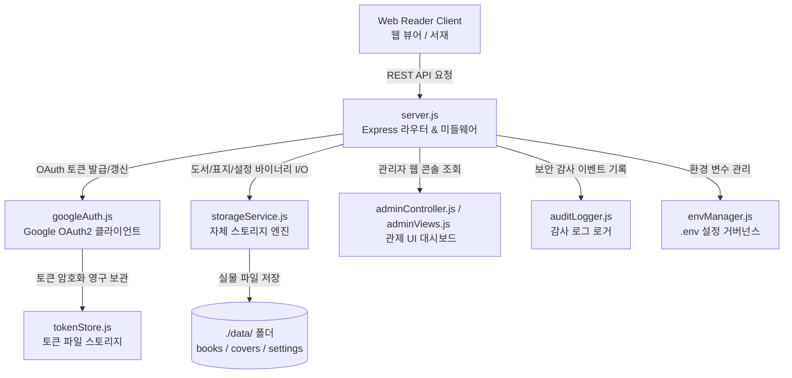

# 📄 Refresh & Storage Server - 기술 사양 및 파일 안내서
> **기준 경로**: `refresh-server` | **구조**: Ultra-Compact Modular Server Specs (Optimized for LLM Context)

> **[🤖 AI Context Instructions]**
> - **Architecture**: `Client(Web Reader)` -> `server.js`(Express API) -> `storageService.js`(File I/O) / `googleAuth.js`(OAuth) / `adminController.js`
> - **Storage Rule**: 도서 바이너리(`/api/storage/books/:id/epub`), 표지(`/api/storage/covers/:fileName`), 설정(`/api/storage/settings/:name`)으로 분기 제어합니다.
> - **Security Rule**: 모든 토큰은 `tokenStore.js`를 거쳐 안전하게 관리되며, 모든 주요 관리자 액션은 `auditLogger.js`를 통해 추적됩니다.

---
## 🛠 1. 전체 서버 시스템 아키텍처 흐름

---
## 📁 2. 파일 카탈로그 요약

### 🖥️ EntryPoint (서버 진입점 & 라우팅)
| 파일명 | 파일 경로 | 라인 | 용량 | 역할 요약 |
| :--- | :--- | :---: | :---: | :--- |
| **`server.js`** | `server.js` | 121 | 5.6 KB | server.js |

### 🖥️ Auth & Security (인증 & 토큰 보안)
| 파일명 | 파일 경로 | 라인 | 용량 | 역할 요약 |
| :--- | :--- | :---: | :---: | :--- |
| **`authRoutes.js`** | `src/routes/authRoutes.js` | 263 | 10.5 KB | src/routes/authRoutes.js |
| **`envManager.js`** | `src/envManager.js` | 152 | 6.1 KB | src/envManager.js |
| **`googleAuth.js`** | `googleAuth.js` | 200 | 7.1 KB | googleAuth.js |
| **`tokenStore.js`** | `tokenStore.js` | 131 | 4.2 KB | tokenStore.js |

### 🖥️ Storage Engine (자체 스토리지 서비스)
| 파일명 | 파일 경로 | 라인 | 용량 | 역할 요약 |
| :--- | :--- | :---: | :---: | :--- |
| **`adminLibraryInspector.js`** | `src/services/storage/adminLibraryInspector.js` | 499 | 18.4 KB | src/services/storage/adminLibraryInspector.js |
| **`bookStorageEngine.js`** | `src/services/storage/bookStorageEngine.js` | 464 | 18.3 KB | src/services/storage/bookStorageEngine.js |
| **`remoteLibraryEngine.js`** | `src/services/storage/remoteLibraryEngine.js` | 302 | 10.7 KB | src/services/storage/remoteLibraryEngine.js |
| **`settingsStorageEngine.js`** | `src/services/storage/settingsStorageEngine.js` | 188 | 5.9 KB | src/services/storage/settingsStorageEngine.js |
| **`storageContext.js`** | `src/services/storage/storageContext.js` | 226 | 8.7 KB | src/services/storage/storageContext.js |
| **`storageRoutes.js`** | `src/routes/storageRoutes.js` | 823 | 35.7 KB | src/routes/storageRoutes.js |
| **`storageService.js`** | `src/storageService.js` | 124 | 3.7 KB | src/storageService.js |

### 🖥️ Admin & Monitoring (관리자 관제 & 감사 로그)
| 파일명 | 파일 경로 | 라인 | 용량 | 역할 요약 |
| :--- | :--- | :---: | :---: | :--- |
| **`adminAuthViews.js`** | `src/views/adminAuthViews.js` | 205 | 6.1 KB | src/views/adminAuthViews.js |
| **`adminController.js`** | `src/adminController.js` | 965 | 37.1 KB | src/adminController.js |
| **`adminDashboardTab.js`** | `src/views/adminDashboardTab.js` | 584 | 28.5 KB | src/views/adminDashboardTab.js |
| **`adminFolderModal.js`** | `src/views/adminFolderModal.js` | 259 | 10.0 KB | src/views/adminFolderModal.js |
| **`adminLibraryRoutes.js`** | `src/routes/adminLibraryRoutes.js` | 129 | 4.6 KB | src/routes/adminLibraryRoutes.js |
| **`adminSettingsTab.js`** | `src/views/adminSettingsTab.js` | 404 | 20.0 KB | src/views/adminSettingsTab.js |
| **`adminSharedFoldersTab.js`** | `src/views/adminSharedFoldersTab.js` | 463 | 20.9 KB | src/views/adminSharedFoldersTab.js |
| **`adminUserLibraryModal.js`** | `src/views/adminUserLibraryModal.js` | 416 | 25.5 KB | src/views/adminUserLibraryModal.js |
| **`adminUsersTab.js`** | `src/views/adminUsersTab.js` | 662 | 33.1 KB | src/views/adminUsersTab.js |
| **`adminViews.js`** | `src/adminViews.js` | 828 | 25.1 KB | src/adminViews.js |
| **`auditLogger.js`** | `src/auditLogger.js` | 480 | 18.2 KB | src/auditLogger.js |

### 🖥️ Config & Metadata (설정 및 패키지)
| 파일명 | 파일 경로 | 라인 | 용량 | 역할 요약 |
| :--- | :--- | :---: | :---: | :--- |
| **`apiKeyManager.js`** | `src/apiKeyManager.js` | 887 | 34.6 KB | src/apiKeyManager.js |
| **`config.js`** | `config.js` | 57 | 2.3 KB | config.js |
| **`httpUtils.js`** | `src/httpUtils.js` | 366 | 11.2 KB | src/httpUtils.js |
| **`package.json`** | `package.json` | 26 | 572 B | 서버 보조 모듈 및 설정 |
| **`securityGuard.js`** | `src/securityGuard.js` | 116 | 5.1 KB | src/securityGuard.js |
| **`systemMonitor.js`** | `src/systemMonitor.js` | 568 | 21.7 KB | src/systemMonitor.js |
| **`systemRoutes.js`** | `src/routes/systemRoutes.js` | 823 | 35.7 KB | src/routes/storageRoutes.js |

---
## 🧩 3. 핵심 모듈 공개 인터페이스 (Public APIs)

> *서버 핵심 모듈의 의존성 및 Export 인터페이스 명세입니다.*

#### 📄 `config.js`
- **참조 (Dependencies)**: `envManager.js`
- **핵심 API (Exports)**: `config`

#### 📄 `googleAuth.js`
- **참조 (Dependencies)**: `config.js`, `tokenStore.js`
- **핵심 API (Exports)**: `generateAuthUrl()`, `verifyState()`, `exchangeCodeForTokens()`, `getFreshAccessToken()`

#### 📄 `server.js`
- **참조 (Dependencies)**: `adminController.js`, `authRoutes.js`, `config.js`, `httpUtils.js`, `securityGuard.js`, `storageRoutes.js`, `systemMonitor.js`, `systemRoutes.js`, `tokenStore.js`

#### 📄 `src/adminController.js`
- **참조 (Dependencies)**: `adminLibraryRoutes.js`, `adminViews.js`, `apiKeyManager.js`, `auditLogger.js`, `envManager.js`, `securityGuard.js`, `storageService.js`
- **핵심 API (Exports)**: `parseCookies()`, `isAuthenticated()`, `createAdminSession()`, `destroyAdminSession()`, `handleAdminRoute()`

#### 📄 `src/adminViews.js`
- **참조 (Dependencies)**: `adminAuthViews.js`, `adminDashboardTab.js`, `adminFolderModal.js`, `adminSettingsTab.js`, `adminSharedFoldersTab.js`, `adminUsersTab.js`, `auditLogger.js`, `config.js`, `envManager.js`, `storageService.js`, `tokenStore.js`
- **핵심 API (Exports)**: `renderAdminSettingsHtml()`

#### 📄 `src/apiKeyManager.js`
- **참조 (Dependencies)**: `securityGuard.js`
- **핵심 API (Exports)**: `hashApiKey()`

#### 📄 `src/auditLogger.js`
- **참조 (Dependencies)**: `envManager.js`, `securityGuard.js`, `systemMonitor.js`
- **핵심 API (Exports)**: `parseDeviceLabel()`

#### 📄 `src/envManager.js`
- **핵심 API (Exports)**: `readEnvFile()`, `writeEnvFile()`, `ensureStorageDirectories()`

#### 📄 `src/httpUtils.js`
- **참조 (Dependencies)**: `config.js`, `envManager.js`, `securityGuard.js`
- **핵심 API (Exports)**: `getClientIp()`, `checkRateLimit()`, `checkOtpRateLimit()`, `recordOtpFailure()`, `clearOtpFailure()`, `extractApiKey()`, `extractDeviceInfo()`, `isAllowedClientOrigin()`, `setCorsHeaders()`, `sendJsonResponse()`, `sendHtmlResponse()`, `readRequestBodyBuffer()`

#### 📄 `src/routes/adminLibraryRoutes.js`
- **참조 (Dependencies)**: `auditLogger.js`, `httpUtils.js`
- **핵심 API (Exports)**: `handleAdminLibraryRoute()`

#### 📄 `src/routes/authRoutes.js`
- **참조 (Dependencies)**: `adminController.js`, `apiKeyManager.js`, `auditLogger.js`, `envManager.js`, `googleAuth.js`
- **핵심 API (Exports)**: `handleAuthRoute()`

#### 📄 `src/routes/storageRoutes.js`
- **참조 (Dependencies)**: `adminController.js`, `apiKeyManager.js`, `auditLogger.js`, `envManager.js`, `storageService.js`
- **핵심 API (Exports)**: `handleStorageRoute()`

#### 📄 `src/routes/systemRoutes.js`
- **참조 (Dependencies)**: `adminController.js`, `apiKeyManager.js`, `auditLogger.js`, `envManager.js`, `storageService.js`
- **핵심 API (Exports)**: `handleStorageRoute()`

#### 📄 `src/securityGuard.js`
- **핵심 API (Exports)**: `validateSafePath()`, `isAllowedBookFile()`, `injectSecurityHeaders()`, `maskSensitiveLog()`

#### 📄 `src/services/storage/adminLibraryInspector.js`
- **참조 (Dependencies)**: `bookStorageEngine.js`, `securityGuard.js`
- **핵심 API (Exports)**: `inspectUserLibrary()`, `deleteUserBookAsset()`, `removeUserTombstone()`

#### 📄 `src/services/storage/bookStorageEngine.js`
- **참조 (Dependencies)**: `securityGuard.js`
- **핵심 API (Exports)**: `getUnifiedSnapshot()`, `saveBookMetadata()`, `getBookMetadata()`, `saveBookEpub()`, `getBookEpubPath()`, `saveCoverImage()`, `getCoverImagePath()`, `deleteCoverImage()`, `deleteBookAll()`

#### 📄 `src/services/storage/remoteLibraryEngine.js`
- **참조 (Dependencies)**: `bookStorageEngine.js`, `securityGuard.js`
- **핵심 API (Exports)**: `testDirectoryPermissions()`, `getDirectoryTree()`, `getRemoteBooks()`, `getRemoteBookFilePath()`, `importRemoteBookToLibrary()`

#### 📄 `src/services/storage/settingsStorageEngine.js`
- **참조 (Dependencies)**: `securityGuard.js`
- **핵심 API (Exports)**: `saveSettingsFile()`, `getSettingsFile()`, `saveCrashReport()`, `getCrashReportsList()`, `getCrashReportPath()`, `deleteCrashReport()`, `clearAllCrashReports()`

#### 📄 `src/services/storage/storageContext.js`
- **참조 (Dependencies)**: `securityGuard.js`
- **핵심 API (Exports)**: `sanitizeFileName()`, `generateFilenameCandidates()`, `resolveSafeRelativePath()`, `ensureDir()`, `readJsonSafely()`, `writeJsonSafely()`, `calculateDirSizeBytes()`, `resolveStorageContext()`, `checkUserStorageQuota()`

#### 📄 `src/storageService.js`
- **핵심 API (Exports)**: `storageService`

#### 📄 `src/systemMonitor.js`
- **참조 (Dependencies)**: `envManager.js`
- **핵심 API (Exports)**: `systemMonitor`

#### 📄 `src/views/adminAuthViews.js`
- **핵심 API (Exports)**: `renderAuthGateHtml()`, `renderLoginPageHtml()`

#### 📄 `src/views/adminDashboardTab.js`
- **참조 (Dependencies)**: `auditLogger.js`, `systemMonitor.js`
- **핵심 API (Exports)**: `renderDashboardTab()`

#### 📄 `src/views/adminFolderModal.js`
- **핵심 API (Exports)**: `renderFolderModalAndScript()`

#### 📄 `src/views/adminSettingsTab.js`
- **핵심 API (Exports)**: `renderSettingsTab()`

#### 📄 `src/views/adminSharedFoldersTab.js`
- **참조 (Dependencies)**: `apiKeyManager.js`, `storageService.js`
- **핵심 API (Exports)**: `getSharedFoldersConfig()`, `resolveAllUsersAndDevices()`, `renderSharedFoldersTab()`

#### 📄 `src/views/adminUserLibraryModal.js`
- **핵심 API (Exports)**: `renderUserLibraryModalAndScript()`

#### 📄 `src/views/adminUsersTab.js`
- **참조 (Dependencies)**: `adminUserLibraryModal.js`, `apiKeyManager.js`
- **핵심 API (Exports)**: `renderUsersTab()`

#### 📄 `tokenStore.js`
- **참조 (Dependencies)**: `config.js`
- **핵심 API (Exports)**: `saveRefreshToken()`, `getRefreshToken()`, `hasRefreshToken()`, `deleteRefreshToken()`
