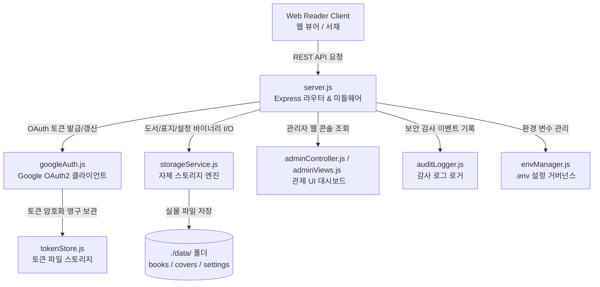

# 📄 Refresh & Storage Server - 기술 사양 및 파일 안내서
> **기준 경로**: `refresh-server` | **구조**: Ultra-Compact Modular Server Specs (Optimized for LLM Context)

> **[🤖 AI Context Instructions]**
> - **Architecture**: `Client(Web Reader)` -> `server.js`(Express API) -> `storageService.js`(File I/O) / `googleAuth.js`(OAuth) / `adminController.js`
> - **Storage Rule**: 도서 바이너리(`/api/storage/books/:id/epub`), 표지(`/api/storage/covers/:fileName`), 설정(`/api/storage/settings/:name`)으로 분기 제어합니다.
> - **Security Rule**: 모든 토큰은 `tokenStore.js`를 거쳐 안전하게 관리되며, 모든 주요 관리자 액션은 `auditLogger.js`를 통해 추적됩니다.

---
## 🛠 1. 전체 서버 시스템 아키텍처 흐름

---
## 📁 2. 파일 카탈로그 요약

### 🖥️ EntryPoint (서버 진입점 & 라우팅)
| 파일명 | 파일 경로 | 라인 | 용량 | 역할 요약 |
| :--- | :--- | :---: | :---: | :--- |
| **`server.js`** | `server.js` | 1035 | 42.5 KB | server.js |

### 🖥️ Auth & Security (인증 & 토큰 보안)
| 파일명 | 파일 경로 | 라인 | 용량 | 역할 요약 |
| :--- | :--- | :---: | :---: | :--- |
| **`envManager.js`** | `src/envManager.js` | 92 | 3.8 KB | src/envManager.js |
| **`googleAuth.js`** | `googleAuth.js` | 158 | 5.4 KB | googleAuth.js |
| **`tokenStore.js`** | `tokenStore.js` | 131 | 4.2 KB | tokenStore.js |

### 🖥️ Storage Engine (자체 스토리지 서비스)
| 파일명 | 파일 경로 | 라인 | 용량 | 역할 요약 |
| :--- | :--- | :---: | :---: | :--- |
| **`storageService.js`** | `src/storageService.js` | 1043 | 41.0 KB | src/storageService.js |

### 🖥️ Admin & Monitoring (관리자 관제 & 감사 로그)
| 파일명 | 파일 경로 | 라인 | 용량 | 역할 요약 |
| :--- | :--- | :---: | :---: | :--- |
| **`adminAuthViews.js`** | `src/views/adminAuthViews.js` | 205 | 6.1 KB | src/views/adminAuthViews.js |
| **`adminController.js`** | `src/adminController.js` | 912 | 34.9 KB | src/adminController.js |
| **`adminDashboardTab.js`** | `src/views/adminDashboardTab.js` | 335 | 17.9 KB | src/views/adminDashboardTab.js |
| **`adminFolderModal.js`** | `src/views/adminFolderModal.js` | 196 | 8.3 KB | src/views/adminFolderModal.js |
| **`adminSettingsTab.js`** | `src/views/adminSettingsTab.js` | 230 | 11.0 KB | src/views/adminSettingsTab.js |
| **`adminUsersTab.js`** | `src/views/adminUsersTab.js` | 570 | 28.9 KB | src/views/adminUsersTab.js |
| **`adminViews.js`** | `src/adminViews.js` | 729 | 21.7 KB | src/adminViews.js |
| **`auditLogger.js`** | `src/auditLogger.js` | 415 | 16.1 KB | src/auditLogger.js |

### 🖥️ Config & Metadata (설정 및 패키지)
| 파일명 | 파일 경로 | 라인 | 용량 | 역할 요약 |
| :--- | :--- | :---: | :---: | :--- |
| **`apiKeyManager.js`** | `src/apiKeyManager.js` | 710 | 26.8 KB | src/apiKeyManager.js |
| **`config.js`** | `config.js` | 56 | 1.8 KB | config.js |
| **`package.json`** | `package.json` | 26 | 572 B | 서버 보조 모듈 및 설정 |
| **`securityGuard.js`** | `src/securityGuard.js` | 116 | 5.1 KB | src/securityGuard.js |

---
## 🧩 3. 핵심 모듈 공개 인터페이스 (Public APIs)

> *서버 핵심 모듈의 의존성 및 Export 인터페이스 명세입니다.*

#### 📄 `config.js`
- **핵심 API (Exports)**: `config`

#### 📄 `googleAuth.js`
- **참조 (Dependencies)**: `config.js`, `tokenStore.js`
- **핵심 API (Exports)**: `generateAuthUrl()`, `verifyState()`, `exchangeCodeForTokens()`, `getFreshAccessToken()`

#### 📄 `server.js`
- **참조 (Dependencies)**: `adminController.js`, `apiKeyManager.js`, `auditLogger.js`, `config.js`, `envManager.js`, `googleAuth.js`, `securityGuard.js`, `storageService.js`, `tokenStore.js`

#### 📄 `src/adminController.js`
- **참조 (Dependencies)**: `adminViews.js`, `apiKeyManager.js`, `auditLogger.js`, `envManager.js`, `securityGuard.js`, `storageService.js`
- **핵심 API (Exports)**: `parseCookies()`, `isAuthenticated()`, `createAdminSession()`, `destroyAdminSession()`, `handleAdminRoute()`

#### 📄 `src/adminViews.js`
- **참조 (Dependencies)**: `adminAuthViews.js`, `adminDashboardTab.js`, `adminFolderModal.js`, `adminSettingsTab.js`, `adminUsersTab.js`, `auditLogger.js`, `config.js`, `envManager.js`, `storageService.js`, `tokenStore.js`
- **핵심 API (Exports)**: `renderAdminSettingsHtml()`

#### 📄 `src/apiKeyManager.js`
- **참조 (Dependencies)**: `securityGuard.js`
- **핵심 API (Exports)**: `hashApiKey()`

#### 📄 `src/auditLogger.js`
- **참조 (Dependencies)**: `envManager.js`, `securityGuard.js`
- **핵심 API (Exports)**: `parseDeviceLabel()`

#### 📄 `src/envManager.js`
- **핵심 API (Exports)**: `readEnvFile()`, `writeEnvFile()`, `ensureStorageDirectories()`

#### 📄 `src/securityGuard.js`
- **핵심 API (Exports)**: `validateSafePath()`, `isAllowedBookFile()`, `injectSecurityHeaders()`, `maskSensitiveLog()`

#### 📄 `src/storageService.js`
- **참조 (Dependencies)**: `securityGuard.js`
- **핵심 API (Exports)**: `storageService`

#### 📄 `src/views/adminAuthViews.js`
- **핵심 API (Exports)**: `renderAuthGateHtml()`, `renderLoginPageHtml()`

#### 📄 `src/views/adminDashboardTab.js`
- **참조 (Dependencies)**: `auditLogger.js`
- **핵심 API (Exports)**: `renderDashboardTab()`

#### 📄 `src/views/adminFolderModal.js`
- **핵심 API (Exports)**: `renderFolderModalAndScript()`

#### 📄 `src/views/adminSettingsTab.js`
- **핵심 API (Exports)**: `renderSettingsTab()`

#### 📄 `src/views/adminUsersTab.js`
- **참조 (Dependencies)**: `apiKeyManager.js`
- **핵심 API (Exports)**: `renderUsersTab()`

#### 📄 `tokenStore.js`
- **참조 (Dependencies)**: `config.js`
- **핵심 API (Exports)**: `saveRefreshToken()`, `getRefreshToken()`, `hasRefreshToken()`, `deleteRefreshToken()`
