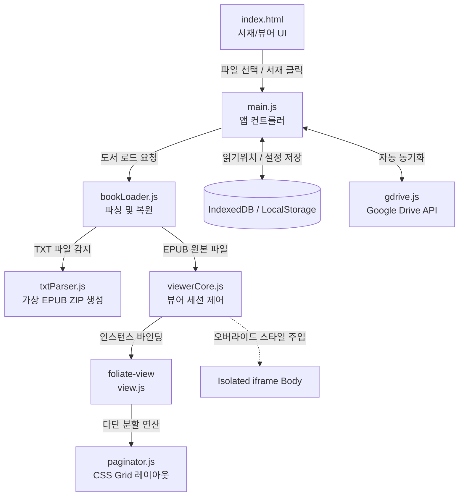

# 📄 EPUB Web Viewer - 기술 사양 및 파일 안내서
> **기준 경로**: `refresh-server` | **구조**: Ultra-Compact Modular Specs (Optimized for LLM Context)

> **[🤖 AI Context Instructions]**
> - **Architecture**: `main.js` -> `viewerCore.js` -> `bookLoader.js`/`txtParser.js` -> `view.js`(iframe 격리) -> `db.js`/`gdrive.js`
> - **Isolation Rule**: iframe 본문 스타일 오버라이드는 `viewerCore.js`를 거쳐 주입합니다.
> - **Code Policy**: `web/foliate-js/` 코어는 직접 수정하지 않고 Wrapper 모듈로 확장합니다. 코드 안내 시 수정 대상 함수는 Full Code를 출력합니다.

---
## 🛠 1. 전체 시스템 아키텍처 흐름

---
## 📁 2. 파일 카탈로그 요약

### 🖥️ Foliate-js Core Engine (오픈소스 코어)
| 파일명 | 파일 경로 | 라인 | 용량 | 역할 요약 |
| :--- | :--- | :---: | :---: | :--- |

### 🖥️ Styles & Config (스타일 및 설정)
| 파일명 | 파일 경로 | 라인 | 용량 | 역할 요약 |
| :--- | :--- | :---: | :---: | :--- |
| **`adminController.js`** | `src/adminController.js` | 765 | 24.7 KB | src/adminController.js |
| **`config.js`** | `config.js` | 56 | 1.8 KB | config.js |
| **`envManager.js`** | `src/envManager.js` | 80 | 2.8 KB | src/envManager.js |
| **`googleAuth.js`** | `googleAuth.js` | 158 | 5.4 KB | googleAuth.js |
| **`package.json`** | `package.json` | 26 | 572 B | 프로젝트 보조 모듈 및 설정 |
| **`server.js`** | `server.js` | 663 | 24.8 KB | server.js |
| **`storageService.js`** | `src/storageService.js` | 439 | 14.9 KB | src/storageService.js |
| **`tokenStore.js`** | `tokenStore.js` | 131 | 4.2 KB | tokenStore.js |

---
## 🧩 3. 핵심 모듈 공개 인터페이스 (Public APIs)

> *수정 및 확장 대상이 되는 핵심 모듈의 의존성 및 Export 인터페이스 명세입니다.*
